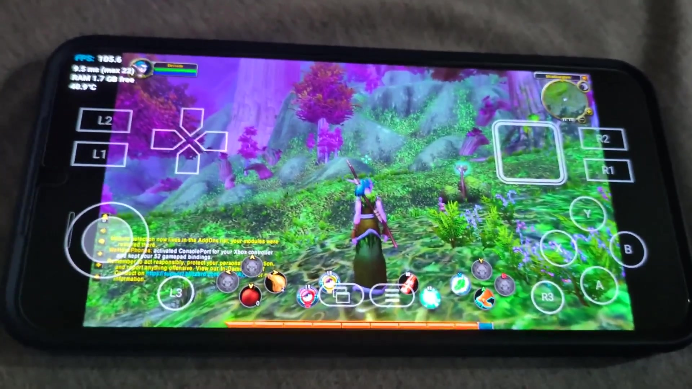

# WeHavePhones

We do have phones, and also Wine.

Winlator fork for running World of Warcraft (ARM64 Windows version) and Battle.net on Android phones.

Controller support.\
Built-in addon manager, with optional CurseForge and WowUp apps.

> **Alpha build:** WeHavePhones is still in development. Expect bugs, rough edges, and compatibility differences between phones. Report problems through Diagnostics in the app.

[](https://www.youtube.com/watch?v=4wet8as_QfA)

## Tested on

All WoW versions have been tested and confirmed playable on the **Samsung Galaxy S23+**: Forever, Classic Era, BC Anniversary, MOP Classic, and Retail.

Other tested devices:

- Google Pixel 8a
- OnePlus 15
- Lenovo Idea Tab Pro Gen 2
- Xiaomi Pad 8 Pro
- Samsung Galaxy S26 Ultra

See the [full device and driver chart](docs/TESTED_DEVICES.md) for details and community reports.

## Install

1. Download the latest APK from [Releases](https://github.com/ashmerra/wehavephones/releases).
2. Allow your browser or file manager to install unknown apps, then open the APK.
3. Open WeHavePhones and follow Setup: prepare the container, install Battle.net, sign in, and download your WoW version (or import existing files as described below).
4. When the game finishes installing, close Battle.net: swipe in from the left edge of the screen to open the side menu, then tap Exit. Launching the game from the Battle.net window is not recommended.
5. Back in the WeHavePhones app, press Play.

Already have WoW installed on a Windows PC? Once the container and Battle.net are ready:

1. Copy your entire **World of Warcraft** folder into the phone's **Downloads**.
2. In WeHavePhones, tap **Setup → Import WoW files** and wait.
3. Open Battle.net, choose the matching game version, and use **Locate the game** to select the imported folder. Finish updates, exit through the side menu, then press **Play** in WeHavePhones.

Allow space for two copies during import. Battle.net may still download missing
files or updates. See [detailed instructions](docs/REUSE_WOW_FILES.md).

You need a 64-bit ARM phone with Android 8.0 or newer and enough free space for the game.

## Build from source

```bash
# x86_64 Linux or WSL2 with git, curl and python3; about 10 GB free
git clone https://github.com/ashmerra/wehavephones.git
cd wehavephones
scripts/setup-dev.sh           # JDK 17 + Android SDK/NDK in .tools/ (~5 GB)
scripts/build-wehavephones.sh  # fetches pinned assets, builds the APK
```

The APK is written to `app/build/outputs/apk/wehavephones/debug/app-wehavephones-debug.apk`. A debug build installs as a separate app, WeHavePhones Dev (`com.wehavephones.dev`), next to an official release. `scripts/deploy-wehavephones.sh` builds it, installs it and launches it over adb. Set `ANDROID_DEVICE` in a gitignored `local.env` or pass `--serial`. Large prebuilt assets are pinned by SHA-256. See [docs/BUILD_ASSETS.md](docs/BUILD_ASSETS.md).

## Documentation

- [Reuse existing WoW game files](docs/REUSE_WOW_FILES.md)
- [App architecture](docs/WEHAVEPHONES_APP.md)
- [Runtime and the patched Wine ntdll](docs/WEHAVEPHONES_RUNTIME.md)
- [Addon manager](docs/WEHAVEPHONES_ADDONS.md)
- [Input Bridge on-screen keys](docs/INPUT_BRIDGE.md)
- [Device profiles](docs/DEVICE_PROFILES.md)
- [Device reports](docs/DEVICE_REPORTS.md)
- [Tested devices and graphics drivers](docs/TESTED_DEVICES.md)
- [Build assets](docs/BUILD_ASSETS.md)

## Credits

WeHavePhones builds on [Winlator LLM](https://github.com/FrontMage/winlator-llm)
by FrontMage, which builds on [Winlator](https://github.com/brunodev85/winlator)
by BrunoSX. Their Android application and Windows runtime integration make this
project possible.

Thanks to the [FEX developers](https://github.com/FEX-Emu/FEX) for FEX, the
[Mesa](https://www.mesa3d.org) Turnip developers, and
[The412Banner](https://github.com/The412Banner/proton-wine) for the GE-Proton
arm64ec builds WeHavePhones runs on. Controller support is powered by
[ConsolePort](https://github.com/seblindfors/ConsolePort) by Sebastian
Lindfors, which WeHavePhones downloads and installs as a WoW addon.

## License

The code in this fork is MIT-licensed. The original copyright and license are
retained in [LICENSE](LICENSE). Bundled components keep their own licenses,
listed with their sources in [THIRD_PARTY_NOTICES.md](THIRD_PARTY_NOTICES.md).

## Trademarks and disclaimer

WeHavePhones is an independent, unofficial project. It is not affiliated with,
endorsed, sponsored, or approved by Blizzard Entertainment, Inc., Microsoft,
or the Winlator projects. WeHavePhones includes no Blizzard game files or
assets. Users need their own Blizzard account and game license and install the
game themselves through Battle.net.

Blizzard does not officially support running its games through Wine or on
Android and offers no technical support for these setups. As with any account,
Blizzard can suspend or close accounts at its discretion under its terms of
service. Use WeHavePhones at your own risk.
WeHavePhones never asks for, stores or types your Battle.net credentials. You
sign in inside Battle.net itself.

World of Warcraft, Warcraft, Battle.net and Blizzard Entertainment are
trademarks or registered trademarks of Blizzard Entertainment, Inc. in the U.S.
and/or other countries. All other trademarks are the property of their
respective owners.
